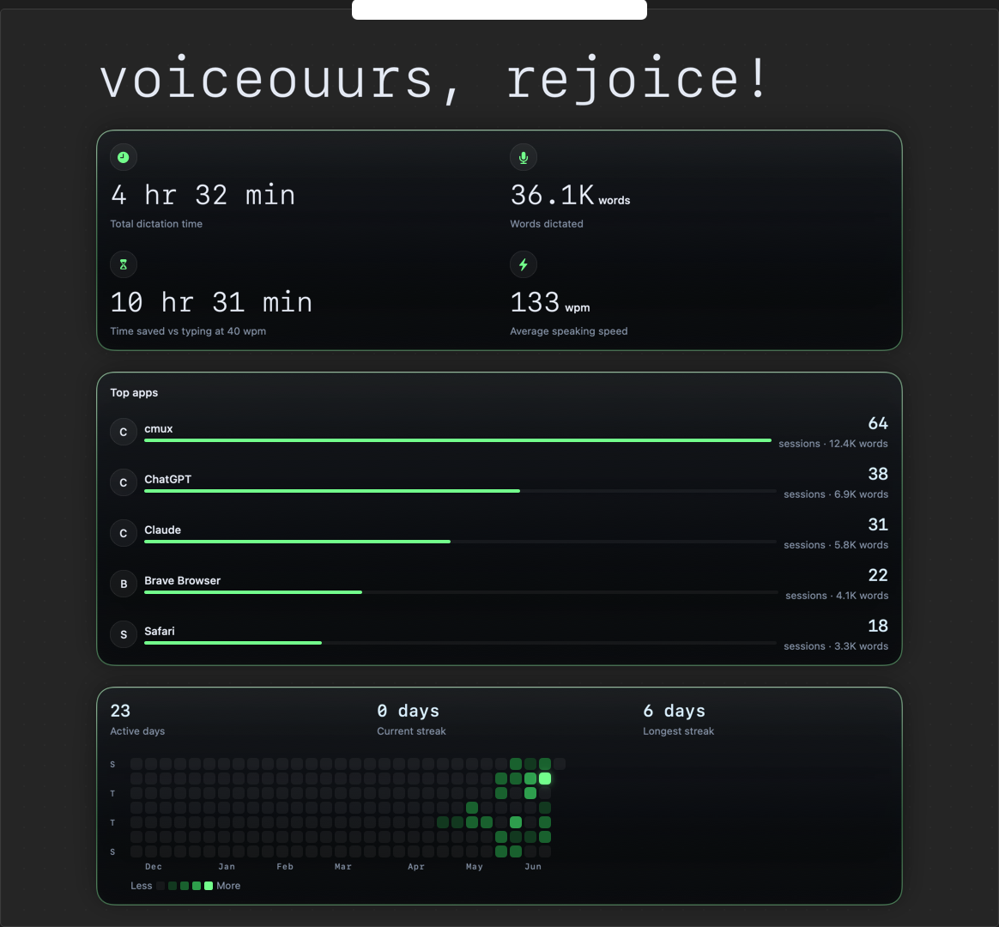
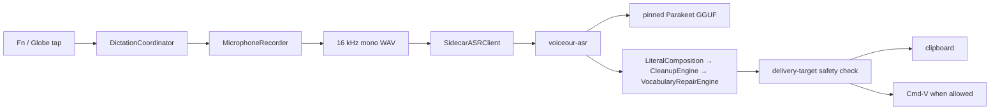

<div align="center">


# Voiceour

<p><strong>Tap <code>fn</code> to dictate where your cursor is.</strong></p>

<sub>macOS 27+ · Apple Silicon only · English only · initial 1.26 GB model download</sub>

</div>

## How it works

Tap Fn once and speak. Tap again and the text lands in the app you were already using — recorded, recognized, and cleaned up entirely on your Mac. Ordinary text fields get the paste; a terminal, a code editor, a password field, or a target Voiceour could not read gets the transcript on the clipboard instead, and no setting widens that.

Terms you teach in the Glossary do more than fix spelling: Voiceour also repairs close phonetic mishearings of them, by deterministic matching against your own terms rather than a model rewriting your words. Terms that are ordinary English words are held out of that phonetic step, so a word you actually said is never traded for one that merely sounds like something you taught.

No account, no telemetry, no cloud transcription. The only network request downloads the pinned recognition model. Settings offers two conversions of that one model — Balanced and Compact — that transcribe the same to within what the benchmarks can resolve, so the choice is about disk and memory footprint.

Home keeps the running totals: how long you have spoken, how much typing it saved, and which apps the words went to.

<div align="center">



</div>

This README is Voiceour's product and technical contract: what the app does, how it is put together, what it stores and sends, and how it is built and verified. [AGENTS.md](AGENTS.md) holds the engineering invariants and maintenance workflows that keep this contract true. When code and this document disagree, one of them is a bug.

## Product contract

### One tap, one utterance

- **Start.** Press and release Fn/Globe by itself. Fn held together with another key or modifier is not a dictation gesture and passes through to macOS. The menu's dictation action starts and stops a recording too.
- **Stop.** Tap Fn/Globe again. Voiceour finalizes one recording and decodes it once. The recording island's **Finish** accessibility action does the same. Auto-stop, off by default, ends the recording after a configurable silence (2.5 s by default, 0.5–30 s) once speech has been heard and at least 3 s have passed.
- **Cancel.** An unmodified Escape or the island's **Cancel** action discards an active session, including an in-flight transcription. Its result is neither delivered nor saved, and the cancel sound plays. Escape pressed while text is already being delivered can only stop the paste; a transcript already written to the clipboard stays there.
- A second tap while the recording is being transcribed is ignored. There is no maximum recording length, no live transcript, and no streaming decode.
- A dictation the model cannot serve yet — still downloading or still loading — is refused with its reason in the menu before any microphone prompt. The Microphone permission is requested at the first real recording, never at launch.
- If no input signal arrives within 6 s of starting, the recording stops and reports that no audio was heard. A recording whose device disconnected, or whose audio conversion or file write failed, is rejected rather than transcribed truncated. A finished capture whose signal-to-noise ratio says it holds no speech is discarded before recognition, because a speech model invents text from noise rather than returning nothing.
- The recording comes from the microphone chosen in Settings while it is connected. Otherwise it comes from the system default input, except that a Bluetooth headset default is redirected to the built-in microphone while the lid is open, because headset negotiation replaces the first second of a capture with silence. An unplugged choice falls back rather than failing the dictation.
- By default other system audio is muted for the recording with a short fade and restored the moment capture ends, and three session sounds mark start, end, and cancel. Both are switches in Settings.

### What happens to the words

Three deterministic stages run after recognition, in this order, and nothing else rewrites the transcript. No language model or network service touches it, and the same transcript and glossary always produce the same text.

1. **Literal composition** always runs. It turns spoken formatting commands into characters:
   - `spell …`, `spell that …`, and `letter by letter …` join the words that follow into one token; inside that run, `capital X` or `uppercase X` uppercases a word and `dash`, `dash dash`, `dot` and `underscore` become `-`, `--`, `.` and `_`.
   - `snake case …` produces `lower_snake_case`, and `camel case …` produces `lowerCamelCase`.
   - `capital word` or `uppercase word` uppercases that one word.
   - `literal word` emits the next word as text instead of as a command; `literal dash`, `literal dot` and `literal underscore` still emit the symbol.
   - Anywhere in the transcript, the standalone words `dash`, `dash dash`, `dot` and `underscore` become `-`, `--`, `.` and `_`, joined to the text on either side.
   - A command's word run ends at the next punctuation mark.
2. **Cleanup**, on by default, normalizes whitespace, removes the fillers *um, uh, uhm, erm, mmm,* and *hmm*, collapses an immediately repeated phrase of up to four words, restores a sentence's capital letter where a removal exposed a lower-case word, and finally replaces every Glossary heard-as form with its term. Tokens that look like code — flags, paths, numbers, internal capitals — and Glossary spellings are never treated as fillers or recased, and a taught form that itself contains a filler or a stutter is left intact so it can still match.
3. **Vocabulary repair** runs whenever cleanup does. It rewrites a span of up to five words only when it is a near-exact phonetic match for a Glossary term. Terms that are ordinary English words, or two characters or shorter, are never repair targets, and a multi-word span made entirely of ordinary words is never rewritten — the guard that keeps *I am* from becoming *IAM*.

Turning Cleanup off in Settings skips stages 2 and 3 together; literal composition still runs. A transcript that comes out empty ends the session as cancelled and delivers nothing. History keeps both the recognizer's raw text and the delivered text.

### Glossary

- A term is a spelling plus the forms it is heard as. A fresh install starts with seven developer terms, such as `NVIDIA Parakeet`, `NSPasteboard` and `kubectl`. Compound spellings also match their spaced-out forms automatically: `SwiftUI` matches *swift ui* and *swift u i*.
- A term applies in every app. Vocabulary is never scoped to an app or a project. Each dictation uses a snapshot of at most 100 terms, taken when the recording stops: your own corrections and the bundled terms come first, and the remainder fills in trust and recency order.
- Terms are added in four explicit ways: **Teach** from a History transcript (select words and press ⌘T, or right-click a word for *Fix / Teach*), the Glossary tab's editors, accepting a learned suggestion, and importing a word list. A word list is a JSON array of spellings, a JSON array of `{"term": …, "heard_as": […]}` rows, or one spelling per line. An import takes up to 500 terms of up to 64 characters, with up to 8 heard-as forms each.
- An edit that would let one heard-as form mean two different terms is refused as a whole, never partially applied.
- After each dictation Voiceour may propose suggestions: spans that resemble a term. Suggestions are proposals only. They never change the delivered text, live in memory until the next recording, and are applied only when you choose **Teach**. **Never Suggest This** records a rejection, and **Ignore** dismisses one for now. Nothing is ever learned in the background.

### History and Home

- **History** holds the newest 500 dictations delivered to non-secure targets, grouped by day, with search and an app filter. One transcript is open at a time. A click copies the whole transcript; selecting words and pressing ⌘T teaches a correction. Each row's context menu offers Copy Transcript, Fix / Teach a Word, Show Only *App*, and Delete. Raw recognizer text, when it differs, and a Details fold holding the target, stage timings, and the recognizer's least-confident word are collapsed until asked for.
- **Home** reads an aggregate ledger that outlives the 500-row History cap: total dictation time, words, time saved against typing at 40 words per minute, average speaking speed, active days, current and longest streaks, the five apps dictated into most, and an activity grid of 12 to 30 weeks depending on window width. The ledger keeps no transcript text.
- Settings → **Clear History** erases History and the Home ledger together. **Clear Vocabulary** removes every term you taught or imported and returns the surviving bundled terms to their shipped forms.

### Menu, island, and console

- **Menu bar item.** Its popover states the session status, then reports the last transcript, outcome, or failure, then offers the dictation action and commands. Model download and loading progress stays visible here.
- **Recording island.** While recording and processing, a borderless liquid-metal body — liquid mercury in its stock look — appears at the top of the display holding the focused app. Docked, on a display with a camera notch it frames the notch, a liquid collar wrapping the camera housing's sides and bottom, and on other displays it floats as an island near the top centre. Pull the body and it stretches like rubber; pull it 24 points and it tears off as a free island that follows the pointer. Let it go within 48 points of where it docks and it docks again, gliding home or draining and re-forming as the collar; let it go anywhere else and it stays a free island, kept at the same relative spot on whichever display it appears. Only the body takes the mouse: clicks anywhere else around it, and over the menu bar, reach what lies underneath. When focus moves to another display, the body drains into the notch or top edge it is leaving, the empty overlay moves, and the body grows back out of the new display's notch or top edge; with Reduce Motion it moves at once, and docking skips the glide and the drain. It is drawn at that display's native refresh rate, capped at 120 fps: 120 fps on ProMotion, 60 fps on a 60 Hz display. A delivered paste or a cancel dismisses it at once, the body swallowing itself as it fades; a copy-only delivery, a failed delivery, or an error holds a distinct shape for 1.2 s, and every look keeps those shapes: no state is signalled by colour. Its look, chosen in Settings ▸ Island, dresses the collar and the island alike and stays fixed while the body is on screen; a change shows the next time it appears. Reduce Motion keeps it still between words whatever the Shimmer and Slither settings, and Increase Contrast keeps its accessible tone over Brightness and Contrast. VoiceOver reads it as *Dictation status*, with Finish and Cancel as named actions, plus Dock island while the island floats free, and Voiceour announces each stage and any unclean outcome; a clean paste and a cancel stay silent.
- **Console.** One window with four tabs — Home, Glossary, History, Settings — opened from the menu, a Dock-icon click, `open -a Voiceour`, or opening the app again while it runs. Voiceour shows a Dock icon only while the console is open, and the console cannot be minimized. It reopens on the tab last used. A first launch opens it on Home with a first-run card that states the tap gesture, shows the model download, and names the permissions; the card retires after the first delivered dictation.
- **Failures** name the cause — model, engine, timeout, microphone, permission, clipboard, or History save — and offer the recovery action that can fix it. An invalid engine response is rejected without delivering or saving the utterance, and a later attempt starts a clean engine process.

### Settings

Preferences come first and readouts after them:

- **Dictation** — the tap gesture, auto-stop and its silence duration, cleanup.
- **Audio** — microphone (Automatic, or a specific device that keeps its name while unplugged), mute system audio while recording, session sounds.
- **Model** — Balanced or Compact. A change applies at the next launch; Settings marks it *Restart to apply* and offers **Restart Voiceour**.
- **Island** — the recording island's look, which the notch collar wears too. A showroom previews it live as the floating island, in a generated room of its own, in the pose its menu picks: Warming Up, Listening, Speaking, Processing, Copy-Only, Delivery Failed, or Error. It moves only while on screen; under Reduce Motion it holds still except while Play Again plays a gesture. **Another Room** draws a different room, and **Play Again** replays the gesture of an outcome pose. Twelve looks — Stock, Showroom Chrome, Liquid Gold, Candy Apple, Blued Titanium, Chameleon, Oil Slick, Arctic Platinum, Desert Heat, Midnight Cruise, Neon Kit, and Street Racer — and **Surprise Me** set every option at once; settings that match no look are marked *Custom*. Four folds hold the options, each with its own **Restore Stock**: **Material** (metal, coat with its film thickness or candy colour, finish), **Lighting** (Studio or Overcast room, colour temperature, underglow, brightness, contrast), **Body** (size, build, crown, taper), and **Motion** (tempo, viscosity, shimmer, reactivity, slither, morph, drama). The collar's length follows the camera housing, so there Size and Build set only its thickness. Colour comes only from the metal, its coat, and the light in the room; nothing is painted on. A change shows the next time the island appears, and ⌘Z undoes each one. **Dock Island**, available while the island floats free, docks it again as its Dock island VoiceOver action does: around the notch on a display with one, near the top centre elsewhere.
- **Readiness** — backend, model, and microphone status, each with its remediation action.
- **Capture** — whether Fn/Globe capture and paste delivery are available, which is the Accessibility grant.
- **Privacy** — what is stored locally, and **Copy Diagnostics**: build, backend and model state, permission states, microphone selection, saved-session count, and storage paths. Diagnostics never include transcripts.
- **Danger** — Clear History and Clear Vocabulary, each behind a confirmation.

Launched with `--debug`, Settings also shows a development backend picker.

## Architecture



Voiceour is a Swift package: macOS 27, Swift tools 6.4, Swift 6 language mode in every target, Swift Testing, and no external Swift dependencies.

| target | role |
| --- | --- |
| `VoiceCore` (library) | Foundation-only domain logic: settings, session state, ASR wire types, literal composition, cleanup, glossary, vocabulary repair, history and ledger models, failure presentation, safety policy. |
| `VoiceMac` (library) | macOS adapters: capture, fake audio, sidecar process client, target tracking, pasteboard delivery, permissions, hotkeys, system-audio muting, installed-app lookup, word-list import. |
| `Voiceour` (app) | SwiftUI menu, recording island, console, persistence journals, and `DictationCoordinator`, which orchestrates every session. |
| `ASRSidecarCore` | Model acquisition and cache, WAV loading, the Parakeet context, the fake and real backends, and the NDJSON server. |
| `VoiceourASR` | The `voiceour-asr` helper executable, bundled beside the app and signed with it. |
| `VoiceourBench` | `voiceour-bench`, which runs the production path over benchmark manifests. |
| `CGgml`, `CParakeet` | The vendored parakeet.cpp/ggml C and C++ under `Vendor/parakeet/`. |
| `ASRSidecarStub`, `ParakeetMixedQuantize` | A protocol test helper and a research quantization tool. Neither ships in the app. |

`VoiceCore` and `VoiceMac` are also consumed by Syncour, a separate sibling package, so their public API is not private to this repository.

The app runs one child process, `voiceour-asr`, and talks to it in newline-delimited JSON over stdin and stdout. The sidecar owns model acquisition and recognition; the app owns capture, text processing, delivery, persistence, and every UI surface.

Every session moves through one state machine:

```text
idle -> checkingPermissions -> recording -> finalizingAudio -> transcribing -> cleaning
     -> readyToInsert -> pasteAttempted | copiedOnly | insertFailed -> idle
```

`error` and `cancelled` are the other two endings, and both return to `idle`.

The stop path runs in this order:

1. Finalize the WAV, then start restoring muted system audio.
2. Discard a capture that holds no speech.
3. Snapshot the Glossary into the utterance's vocabulary.
4. Transcribe through the sidecar, with a 30 s deadline, and delete the WAV.
5. Apply literal composition, cleanup, and vocabulary repair.
6. Snapshot the delivery target — the app, window, and control focused now, not when recording began.
7. Unless that target is secure, record the dictation in History and the Home ledger together.
8. Deliver by paste or copy, as the target allows, and record the outcome.
9. Compute learned suggestions in the background.

The record-start target only labels the menu's *Will paste into …* line; it never decides delivery.

## Runtime and data

**Processes.** At launch Voiceour starts the sidecar, which begins loading — and on a first launch downloading — the selected model immediately. A model idle for 30 minutes is released from memory and reloaded by the next dictation. A sidecar that crashes, times out, or sends an invalid frame fails the work in flight and is replaced by a fresh process on the next request. Only one bundled Voiceour runs at a time: a duplicate process quits at launch.

**Stored data.** Voiceour keeps its files locally and does not upload recordings or transcripts. Clipboard output follows the [delivery policy](#safety-and-permissions).

| data | where | lifetime |
| --- | --- | --- |
| Settings, island look, and Glossary | `~/Library/Application Support/Voiceour/settings.json` | Until changed or cleared |
| History | `~/Library/Application Support/Voiceour/recent-sessions.json` | Newest 500 rows; Clear History |
| Home ledger | `~/Library/Application Support/Voiceour/dictation-activity.json` | Aggregates; Clear History |
| Mute recovery record | `~/Library/Application Support/Voiceour/mute-owned.flag` | Until the muted device is restored |
| Model and acceleration file | `~/Library/Caches/Voiceour/<variant>/` | Until the variant is switched away from |
| Recordings | `$TMPDIR/voiceour/<uuid>.wav` | Deleted after transcription, cancellation, or failure |
| Island placement (docked, or free at a spot relative to the display), last console tab | User defaults for `com.voiceour.app` | Until moved, docked, or changed |

- Settings, History, and the ledger are written atomically, owner-only, in order, off the main thread. A failed History save is reported and does not block delivery.
- An unreadable settings, History, or ledger file is moved aside as `<name>.corrupt-<timestamp>`, and the reset is reported with that file name. An island option that cannot be read takes its stock value instead; it never sets the settings file aside.
- No audio is kept. Recordings left behind by a crash are swept at the next launch once they are an hour old.
- A History row holds the delivered text, the raw recognizer text, the destination app, the outcome, stage timings, the least-confident word, and whether audio was muted. A dictation delivered to a secure target writes neither a History row nor a ledger entry.
- The ledger holds per-day and per-app counts of sessions, words, and seconds, plus totals and streaks. Day buckets older than 400 days are pruned without reducing the totals. The first launch without a ledger seeds it from the History still on disk.
- If Voiceour quits or crashes while it has system audio muted, the recovery record restores that output device at the next launch, or as soon as the device is present again.

## Model and network contract

Recognition uses one repository at one revision: `ggml-org/parakeet-GGUF` at `35156454d1a39de06863303dd209fd2bed6ee079`, the `parakeet-tdt-0.6b-v3` checkpoint, decoded locally by vendored parakeet.cpp/ggml on Metal. Voiceour supports English dictation. That revision holds two conversions of the same checkpoint:

| Settings name | file | SHA-256 | download | cache after first load |
| --- | --- | --- | --- | --- |
| Balanced (`f16`, default) | `ggml-parakeet-tdt-0.6b-v3-f16.bin` | `833bffc9513b2cae867ee9e51633cfd11e4d51aaa5597c8ac02159385a2b426f` | 1,255,897,319 bytes | about 2.51 GB |
| Compact (`q8_0`) | `ggml-parakeet-tdt-0.6b-v3-q8_0.bin` | `4d64e9e96c2792186d072fde0034df0ad670cf680a2f53069052ead827fd600e` | 668,757,119 bytes | about 1.34 GB |

- **Same transcripts, different footprint.** The two conversions agree to within what the committed benchmark corpus can resolve, so neither is presented as more accurate. Compact saves 587 MB of download and about 1.17 GB of combined cache.
- **The default is not a speed claim.** Balanced is the default and the fallback for an unknown or stale setting. On the development M4 Pro it decoded faster under macOS 26.5.2, while under macOS 26.6.2 the two tied or Compact was slightly faster; decode-speed ordering has moved with the OS and toolchain, and no current ordering is claimed. Changing the default needs cross-SoC replication and the paired real-speaker gate. The dated measurements are in [performance-roadmap.md](docs/performance-roadmap.md) and [benchmarks.md](docs/benchmarks.md).
- **Switching** applies at the next launch. The previous variant's cache directory is removed only after the newly selected variant has loaded successfully, so a switch that fails to download or load leaves the previous weights on disk. Otherwise exactly one variant stays resident.
- **Download.** Only the sidecar's background load downloads; until the model is ready a dictation is refused rather than left waiting. The file comes from `https://huggingface.co/ggml-org/parakeet-GGUF/resolve/35156454d1a39de06863303dd209fd2bed6ee079/<file>`. Voiceour requires the remaining download bytes plus 256 MiB of free disk before fetching, makes up to three resumable attempts, and verifies the completed file against the digest above before accepting it. A cached file is reused only when its manifest and size match the pin exactly. A cached file that fails to load is hashed again; if its bytes no longer match, it is removed and downloaded again in the background, once per process.
- **Acceleration file.** After the verified model first loads, Voiceour writes a model-sized weight arena next to it so later loads are fast. It is generated locally, never downloaded, named after the artifact's digest, and rebuilt if it is stale or incomplete; that is why the cache is about twice the download.
- **The only network request** is that model download. Transcription is entirely local. There is no telemetry, crash reporting, analytics, account, update check, or cloud text processing, and Voiceour stores no credential.
- Like any download, that HTTPS request tells Hugging Face and its CDN your IP address and User-Agent. You can block Voiceour in a firewall such as Little Snitch once the model is cached; without a cached model there is no transcription, though the fake development backend still works.

## Safety and permissions

Voiceour touches the microphone, the active workspace, the clipboard, and the keyboard, so these rules are product-critical.

| permission | when | what it enables |
| --- | --- | --- |
| Microphone | Required; asked at the first real recording | Recording. The fake development backend never asks. |
| Accessibility | Optional | Hiding a solitary Fn/Globe tap from macOS, hiding an unmodified Escape during a session, and posting Cmd-V. Granting it later takes effect without a restart. |
| Input Monitoring | Never requested | — |

Without Accessibility, Voiceour falls back to passive event monitoring, which cannot hide the key from the focused app, and every delivery is copy-only. Accessibility inspection only reads the focused control; it never changes text.

**Where the text goes.** Delivery is a clipboard write followed, only when allowed, by a synthetic Cmd-V. It is never an Accessibility text mutation. The target's class decides the delivery, and no setting changes the mapping:

| target class | examples | delivery |
| --- | --- | --- |
| Normal text | TextEdit, Notes, Mail, browser fields, chat composers | Clipboard, then Cmd-V once permission and target identity checks pass |
| Terminal | Terminal, iTerm2, Ghostty, kitty, WezTerm, Alacritty, Warp | Copy-only; exactly one trailing newline stripped |
| Code editor | VS Code, Cursor, Xcode, Sublime Text, Zed, JetBrains IDEs | Copy-only |
| Secure | Password fields, active secure input, 1Password, Bitwarden | Concealed, host-only copy; no History row or ledger entry |
| Unknown-risky | A focused app whose control could not be inspected | Copy-only; exactly one trailing newline stripped |

Secure input and a secure text role outrank every app classification, and an inspection failure is unknown-risky, never normal text. An app that answers that nothing has keyboard focus is classified by its bundle.

**Clipboard.** Voiceour never reads, saves, or restores what was on the clipboard before; it writes only the transcript. Each write publishes the transcript and its privacy markers as one pasteboard item, so a clipboard manager never sees an unmarked intermediate copy; the concealed and transient markers are advisory to clipboard managers that honour them. A paste carries the transient marker, and 1.5 s after a successful Cmd-V the transcript is removed from the clipboard if nothing else has been copied since. Copy-only deliveries stay on the clipboard. Concealed copies for secure targets stay on this Mac instead of entering Universal Clipboard; ordinary and transient copies follow your Universal Clipboard setting. A failed clipboard write is a failed delivery: no Cmd-V is posted, no clear is scheduled, and nothing claims the text was copied.

**Focus races.** The delivery target is snapshotted just before saving and delivery. Bundle id, process, safety class, and secure-input state are checked again before the clipboard write and again before Cmd-V. Switching apps before the snapshot sends the dictation to the new target; switching after it degrades delivery to copy-only.

## Non-goals

These are product decisions, not deferred roadmap items. Feature requests that cross them will be declined.

- **No live transcript while you speak.** One utterance is decoded once, at stop.
- **No model-based rewriting after recognition.** The text stages are deterministic literal composition, cleanup, and glossary repair.
- **No background listening, wake word, or continuous dictation.**
- **No automatic paste into risky targets**, and no setting that enables it.
- **No per-utterance or per-hour analytics.** Home reads one aggregate, day-resolution ledger.
- **No saved audio.**
- **No telemetry, crash reporting, account, update check, or stored credential.**
- **No second production recognizer.** Local Parakeet is the shipping path; the fake backend exists for development.
- **No language picker.** Voiceour supports English only.
- **No control socket or terminal client.** Microphone and Accessibility grants stay inside the signed app.
- **No Intel or universal build.** The vendored ggml drop is arm64-only by design.

## Development

There is no signed binary release yet, so build from source. You need macOS 27 or newer on Apple Silicon, Xcode 27 with its Swift 6.4 toolchain and macOS 27 SDK, and [`uv`](https://docs.astral.sh/uv/) for the Python benchmark package. `swift format` ships with the toolchain.

```sh
git clone https://github.com/joswha/voiceour.git
cd voiceour
make build
```

`make` on its own prints every target, and [AGENTS.md](AGENTS.md#developer-commands) has the complete command matrix.

Start on the fake backend. It needs no model download and no permission grant: synthetic audio through the real pipeline and real UI.

```sh
make dev
```

Then run the real app. This assembles `.build/Voiceour.app`, stops any running Voiceour, and launches the bundle so macOS attributes permission grants to it. The first launch downloads the selected model with progress in the menu bar and opens the console on Home.

```sh
make run
```

Without a configured signing identity, the bundle is ad-hoc signed and not notarized, so its code identity can change on rebuild and macOS may ask for Microphone and Accessibility again. Run `make signing` once to install a stable local `voiceour-dev` identity that `scripts/bundle.sh` picks up automatically. A signing identity named by `VOICEOUR_CODESIGN_IDENTITY`, and optionally `VOICEOUR_CODESIGN_KEYCHAIN`, in the environment or the repository's ignored `.env` takes precedence. Only the Developer ID path in the [release procedure](AGENTS.md#release-procedure) produces a notarized app for distribution; a local development signature is not a distributable release.

```sh
make status
make stop
make logs
```

`make status` reports the running process, whether the bundle is current, and its signer. `make stop` quits every running Voiceour. `make logs` streams the unified log for subsystem `com.voiceour.app`.

Launch flags go through `ARGS`, as in `make run ARGS="--debug --show-console"`; the app also accepts `--console-section=<tab>`, `--no-activate`, and `--asr-backend <id>`. A `.env` at the repository root is sourced by `make run` and `make dev`, and `make run` forwards `VOICEOUR_ASR_BACKEND`, `VOICEOUR_MODEL_VARIANT` and `VOICEOUR_SUPPORT_DIR` to the bundle explicitly. `VOICEOUR_MODEL_VARIANT=f16|q8_0` pins the model for one launch without changing Settings, and `VOICEOUR_MODEL_CACHE` points the model cache at one explicit directory, which is how a cold download is exercised. [AGENTS.md](AGENTS.md#environment-seams) lists every environment seam.

## Verification

`make check` is the whole local gate. It runs `build`, `format-check`, `check-docs`, `lint-python`, `test`, `ui-flow`, `ui-mercury-bench`, `test-python`, `self-test`, and `bench-smoke`, in that order, and every change runs it before review.

```sh
make check
```

- `make build` treats every Swift, C, and C++ warning as an error.
- `make test` runs the Swift suites, harness suites included, on the fake backend.
- `make check-docs` checks that README.md, AGENTS.md, and NOTICE match the compiled model pin and that every `make` target and script path a live doc names exists.
- `make self-test` launches the debug app with `--self-test`, which checks cleanup output and target classification.
- `make ui-flow` runs the semantic UI journeys, and `make ui-mercury-bench` enforces the recording island's quality and speed gates.
- `make bench-smoke` runs the offline benchmark path on the fake backend.

The default gates use synthetic or fixture audio and offscreen windows. They do not need desktop focus, speaker playback, or microphone access. Live microphone and foreground delivery checks are opt-in; run them only when the person using the Mac agrees to the interruption.

**Opt-in suites.** `VOICEOUR_PARAKEET_INTEGRATION=1 swift test` runs the real-model tests and needs the model cache. `VOICEOUR_CAPTURE_INTEGRATION=1 swift test` opens the real microphone. To prove the cached model end to end:

```sh
make fixture
make build && .build/debug/voiceour-asr --prove fixtures/audio/hello_16k_mono.wav
```

`make fixture` generates that local audio file with `say`; it is not committed.

**UI changes** also run `make ui-snap`. Read the generated `.ax.diff` or `.flow.diff` before blessing a golden with `make ui-update` or `make ui-flow-update`. A scene with an error-severity lint finding or a failing flow cannot be blessed. CI requires semantic flows, but its hosted scene snapshots are advisory: never bless CI raster drift. [ui-harness.md](docs/ui-harness.md) covers the artifacts.

**CI** runs on the `xcode-27` runner, asserts macOS 27, Xcode 27, SDK 27, Swift 6.4 and arm64, and runs build, format, docs, Python lint, Swift tests, semantic flows, Python tests, self-test, and the benchmark smoke. A packaging job builds, bundles, and runs `make verify-bundle` but publishes nothing. The real-model workflow runs weekly and on demand.

**Bundles.** `make verify-bundle` checks the signed `voiceour-asr` helper, arm64-only binaries, packaged resources, `com.voiceour.app`, `LSUIElement`, the microphone usage string, a macOS 27 minimum and SDK on both binaries, and an audio-input-only entitlement set with no sandbox or Input Monitoring entitlement.

**Before a release**, qualify delivery by hand on a clean macOS account with the notarized bundle; `make test` covers these outcomes without posting keystrokes into live apps.

1. Tap Fn/Globe in TextEdit, grant Microphone when prompted, speak once, and stop.
2. Confirm normal text pastes with Accessibility granted, and copies with a stated reason without it.
3. Confirm Ghostty, Zed, a password field, and an unreadable target only copy, and that a terminal copy has no trailing newline.
4. Confirm the password-field dictation creates no History row.
5. Switch to another eligible app during transcription; delivery lands there.
6. Switch focus after the delivery snapshot; delivery is copy-only.

| target | expected | verified by |
| --- | --- | --- |
| TextEdit, Notes, Mail, browser contenteditable | Paste attempted | Manual |
| Electron chat composer | Paste attempted for ordinary text | Manual |
| Terminal, iTerm2, Ghostty | Copy-only, newline stripped | Tests, manual |
| VS Code, Xcode, Zed | Copy-only | Tests, manual |
| Password field | Concealed copy-only, no History row | Tests, manual |
| Focus switch before delivery | Paste into the new target | Tests, multi-display manual |
| Focus switch after the snapshot | Copy-only | Tests, manual |

Releases — source by default, notarized binary only with a Developer ID — follow the [release procedure](AGENTS.md#release-procedure).

## FAQ

<details>
<summary><strong>Why Apple Silicon only?</strong></summary>

The vendored parakeet.cpp/ggml code is arm64-only, and `Vendor/parakeet/ggml/embed/ggml-metal-embed.c` enforces that at compile time. Supporting Intel would mean vendoring upstream's x86 sources and splitting `Package.swift` into per-architecture targets, since SwiftPM has no architecture build condition. It is a [non-goal](#non-goals).

</details>

<details>
<summary><strong>What network requests does Voiceour make?</strong></summary>

Only model acquisition. The [model and network contract](#model-and-network-contract) names the host, files, and digests so you can fetch and hash those exact bytes yourself.

</details>

<details>
<summary><strong>Where does Voiceour keep my data?</strong></summary>

Files stay local. [Runtime and data](#runtime-and-data) lists what they hold and how long they live; [clipboard copies](#safety-and-permissions) follow the system's sharing policy. Clear History in Settings erases transcripts and lifetime counters together.

</details>

<details>
<summary><strong>Which languages does it support?</strong></summary>

English only. The model is `parakeet-tdt-0.6b-v3` and there is no language picker.

</details>

<details>
<summary><strong>Is there a Homebrew install?</strong></summary>

Not yet. A Homebrew cask needs a distributable notarized binary, which the project does not publish. Building from source is the supported path.

</details>

## Troubleshooting

<details>
<summary><strong>The build fails on an older toolchain</strong></summary>

Use Xcode 27 with Swift 6.4 and the macOS 27 SDK, on macOS 27 or newer and Apple Silicon. An older Xcode or Swift toolchain is not sufficient.

</details>

<details>
<summary><strong>macOS keeps asking for Microphone or Accessibility after a rebuild</strong></summary>

macOS ties a permission to the app's code signature, and an ad-hoc development build can get a new one each time. Run `make signing` once for a stable local certificate; `scripts/bundle.sh` picks it up automatically unless an identity is set in the environment or `.env`.

</details>

<details>
<summary><strong>A permission is stuck</strong></summary>

Quit Voiceour, reset it, and it will ask again on the next recording.

```sh
tccutil reset Microphone com.voiceour.app
tccutil reset Accessibility com.voiceour.app
```

</details>

<details>
<summary><strong>Dictation pastes into some apps but only copies in others</strong></summary>

That is deliberate. The [delivery table](#safety-and-permissions) lists which targets are copy-only and why; no setting widens it.

</details>

## Research findings

The three-bet Apple-Silicon study is published with its evidence and rejected paths in the [final research report](research/final-report.md):

- **Technical vocabulary:** deterministic repair and the research-only multi-model teacher raised exact jargon recall from 161/346 to 295/346 while holding the general transcript set unchanged. The ensemble is an evaluation and distillation tool, not a shipping configuration: its artifacts exceed the product's storage contract.
- **Neural Engine execution:** the 6/8/15-second CoreML encoder ladder cut measured compute energy by 57.8%; contamination-resistant ABBA measurement showed a 43.2% reduction. Promotion still needs another Apple Silicon SoC, hosted artifacts, and cold-specialization validation.
- **Quantization:** current-toolchain q8 was quality-non-inferior, tied or faster, and reduced the model download by 587 MB. CPU-tail-only q8 halved the tail weights; broader mixed quantization and margin-only quality prediction did not clear their gates.

These are M4 Pro engineering results, not product claims, and none of them changes the shipping configuration described above. The [research index](research/INDEX.md) links the preregistrations, negative results, measurements, and remaining promotion gates.

## Contributing

Voiceour is MIT licensed, so you're free to read it, fork it, and build your own version.

It's maintained by one person, so I keep the scope tight and won't merge every pull request. Please open an issue before starting anything large, so we can agree on the approach first. Bug reports and ideas are always welcome.

Two things that are especially welcome:

- **Documentation fixes.** Wrong commands, dead links, anything out of date.
- **Fixes under `Vendor/parakeet/`.** That directory is a copy of [ggml-org/whisper.cpp](https://github.com/ggml-org/whisper.cpp). Send those upstream instead — they'll reach every project using it, and they'll survive the next time Voiceour updates its copy.

[CONTRIBUTING.md](CONTRIBUTING.md) has the checks to run before opening a PR.

## Documentation

Two documents are authoritative, and a topic is described in exactly one place:

- **README.md** (this file) — the product and technical contract: behavior, architecture, data, model and network, safety, non-goals, development, and verification.
- **[AGENTS.md](AGENTS.md)** — the engineering invariants, boundaries, protocol and vendor rules, UI and harness rules, commands, and release procedure.

Specialist documents hold derivations, measurements, and runbooks. They never redefine what the app does:

| document | holds |
| --- | --- |
| [ui-harness.md](docs/ui-harness.md) | Offscreen harness commands, artifacts, goldens, scene and flow rules |
| [mercury-renderer.md](docs/mercury-renderer.md) | The recording island's physical model, optics, island-garage materials, lighting and motion law, rejected alternatives, and measured gates |
| [benchmarks.md](docs/benchmarks.md) | Benchmark tiers, metrics, promotion gates, and dated measurement records |
| [performance-roadmap.md](docs/performance-roadmap.md) | Dated latency and throughput measurements |
| [rust-evaluation.md](docs/rust-evaluation.md) | The selective Rust rewrite measurement record |
| [research/](research/INDEX.md) | Preregistrations, experiments, and negative results |
| [CONTRIBUTING.md](CONTRIBUTING.md), [SECURITY.md](SECURITY.md), [CHANGELOG.md](CHANGELOG.md) | PR gates, vulnerability reporting, release notes |

Superseded records live under `docs/archive/` with their dates.

MIT licensed. That covers Voiceour's own code; third-party components keep their own terms. [NOTICE](NOTICE) credits the vendored sources and the speech model, and [benchmarks/DATA-LICENSE.md](benchmarks/DATA-LICENSE.md) covers the CC BY 4.0 corpus transcripts quoted in the committed benchmark reports.

Voiceour is an independent macOS dictation app, not affiliated with, sponsored by, or endorsed by Apple Inc.
