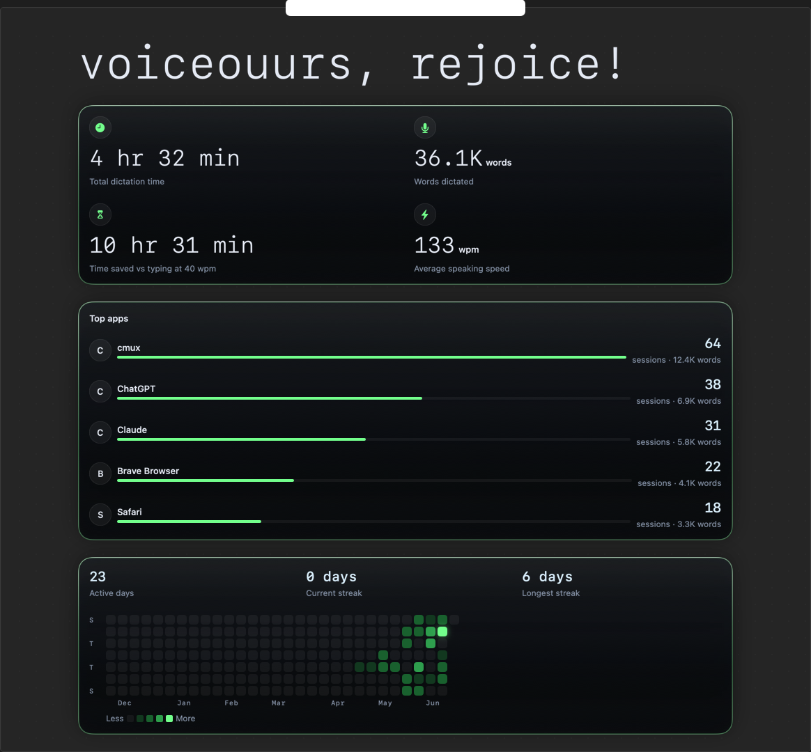
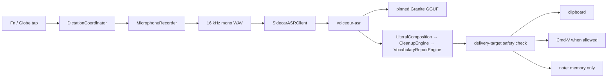

<div align="center">


# Voiceour

<p><strong>Tap <code>fn</code> to dictate where your cursor is.</strong></p>

<sub>macOS 27+ · Apple Silicon only · English, French, German, Spanish, Portuguese, Italian, Japanese · initial 0.51 GB model download</sub>

</div>

## How it works

Tap Fn once and speak. Tap again and the text lands in the app you were already using — recorded, recognized, and cleaned up entirely on your Mac. Ordinary text fields get the paste; a terminal, a code editor, a password field, or a target Voiceour could not read gets the transcript on the clipboard instead, and no setting widens that.

Terms you teach in the Glossary do more than fix spelling: Voiceour also repairs close phonetic mishearings of them, by deterministic matching against your own terms rather than a model rewriting your words. Terms that are ordinary English words are held out of that phonetic step, so a word you actually said is never traded for one that merely sounds like something you taught.

No account, no telemetry, no cloud transcription. Voiceour downloads its pinned recognition model, IBM's Granite Speech 5.0 TurboCTC 470M, and makes one other request only if you opt in: with Settings ▸ Memory ▸ **Sort entries with Jev** on and a TypeSafe key set, the text of each new memory entry, and of earlier entries when you press Sort Entries, goes with your topics to TypeSafe's Jev model, which answers with labels and writes no text ([Model and network contract](#model-and-network-contract)).

Home keeps the running totals: how long you have spoken, how much typing it saved, and which apps the words went to.

<div align="center">



</div>

This README is Voiceour's product and technical contract: what the app does, how it is put together, what it stores and sends, and how it is built and verified. [AGENTS.md](AGENTS.md) maps the engineering contracts and invariants that keep this contract true. When code and this document disagree, one of them is a bug.

## Product contract

### One tap, one utterance

- **Start.** Press and release Fn/Globe by itself. Fn held together with another key or modifier is not a dictation gesture and passes through to macOS. The menu's dictation action starts and stops a recording too, and its **Take a Note** row and the Journal's Notes lens start a recording that is saved as a note instead of delivered ([Notes](#history-and-home)).
- **Stop.** Tap Fn/Globe again. Voiceour finalizes one recording and decodes it once. The recording island's **Finish** accessibility action does the same. Auto-stop, off by default, ends the recording after a configurable silence (2.5 s by default, 0.5–30 s) once speech has been heard and at least 3 s have passed.
- **Cancel.** An unmodified Escape or the island's **Cancel** action discards an active session, including an in-flight transcription. Its result is neither delivered nor saved, and the cancel sound plays. Escape pressed while text is already being delivered can only stop the paste; a transcript already written to the clipboard stays there.
- A second tap while the recording is being transcribed is ignored. There is no maximum recording length, no live transcript, and no streaming decode.
- A dictation the model cannot serve yet — still downloading or still loading — is refused with its reason in the menu before any microphone prompt. The Microphone permission is requested at the first real recording, never at launch.
- If no input signal arrives within 6 s of starting, the recording stops and reports that no audio was heard. A recording whose device disconnected, or whose audio conversion or file write failed, is rejected rather than transcribed truncated. A finished capture whose signal-to-noise ratio says it holds no speech is discarded before recognition, because a speech model invents text from noise rather than returning nothing.
- The recording comes from the microphone chosen in Settings while it is connected. Otherwise it comes from the system default input, except that a Bluetooth headset default is redirected to the built-in microphone while the lid is open, because headset negotiation replaces the first second of a capture with silence. An unplugged choice falls back rather than failing the dictation.
- By default other system audio is muted for the recording with a short fade and restored the moment capture ends, and three session sounds mark start, end, and cancel. Both are switches in Settings.

### What happens to the words

Four deterministic stages run after recognition, in this order, and nothing else rewrites the transcript. No language model or network service touches it, and the same recording and glossary always produce the same text.

There is no language setting: the recognizer transcribes the language you speak, and Voiceour reads that language from the transcript's own words — Japanese by its script, the others by their most common short words. The spoken commands, filler words, repeat collapse and phonetic repair below are English rules, and their words are ordinary words elsewhere: Portuguese *um* means "a", Spanish *capital* is a capital city, German *die die* is grammar. They apply to English and to a transcript too short or too code-like to name a language. A French, German, Spanish, Portuguese, Italian or Japanese transcript keeps every word it was heard with; it gets whitespace normalization and its Glossary heard-as forms, and a one-word term spelled like an ordinary word, such as *Vue*, leaves that word in its prose alone.

1. **Term spotting** runs whenever cleanup does, on an English or undetermined transcript. With each dictation the recognizer is asked whether its own sound evidence spells a Glossary term — its exact spelling, its case forms, or its spaced-out forms, never a heard-as form — over some of the words it wrote, and how much worse that spelling scores than what it wrote. Where the score is within the fixed bound (6 nats in total and 1.5 per token), those words become the term, keeping their outer punctuation. Ordinary-English and two-character terms are never spotted and are never overwritten, a span already holding a term is left alone, and spotting applies only when the recognizer's words are exactly its text. On 282 synthetic dictations of 141 technical terms it raised exact-term hits from 184 to 213, with no lost hit and no false activation over 7,008 rows including 6,583 of real speech ([wave-2 record](research/granite-ctc-word-spotting-wave2-2026-11-06.md)).
2. **Literal composition** runs on every English or undetermined transcript. It turns spoken formatting commands into characters:
   - `spell …`, `spell that …`, and `letter by letter …` join the words that follow into one token; inside that run, `capital X` or `uppercase X` uppercases a word and `dash`, `dash dash`, `dot` and `underscore` become `-`, `--`, `.` and `_`.
   - `snake case …` produces `lower_snake_case`, and `camel case …` produces `lowerCamelCase`.
   - `capital word` or `uppercase word` uppercases that one word.
   - `literal word` emits the next word as text instead of as a command; `literal dash`, `literal dot` and `literal underscore` still emit the symbol.
   - Anywhere in the transcript, the standalone words `dash`, `dash dash`, `dot` and `underscore` become `-`, `--`, `.` and `_`, joined to the text on either side.
   - A command's word run ends at the next punctuation mark.
3. **Cleanup**, on by default, normalizes whitespace, removes the fillers *um, uh, uhm, erm, mmm,* and *hmm*, collapses an immediately repeated phrase of up to four words, restores a sentence's capital letter where a removal exposed a lower-case word, and finally replaces every Glossary heard-as form with its term. A term also corrects the case of its own spelling — *Kubectl* becomes *kubectl* — unless it is a single ordinary English word or two characters or shorter: *Go*, *Rust* or *Swift* in the Glossary never turns the *go*, *rust* or *swift* of ordinary prose into the term, though their heard-as forms still apply. Tokens that look like code — flags, paths, numbers, internal capitals — and Glossary spellings are never treated as fillers or recased, and a taught form that itself contains a filler or a stutter is left intact so it can still match.
4. **Vocabulary repair** runs whenever cleanup does. It rewrites a span of up to five words only when it is a near-exact phonetic match for a Glossary term. Terms that are ordinary English words, or two characters or shorter, are never repair targets, and a multi-word span made entirely of ordinary words is never rewritten — the guard that keeps *I am* from becoming *IAM*.

Turning Cleanup off in Settings skips stages 1, 3 and 4 together; literal composition still runs on English. A transcript that comes out empty ends the session as cancelled and delivers nothing. History keeps both the recognizer's raw text and the delivered text.

**The spoken note command** is read after the four stages, from the text they produced, and is not a text stage: it never changes text that is delivered. When an English or undetermined transcript starts with the words *note to self*, in any case and as whole words, the dictation is saved as a note instead of delivered. The note's text drops only the command and the punctuation right after it, and upper-cases the first letter that follows when it is lower-case; every other character stays as the stages left it. *Note to self* with nothing after it, *note to self's list*, the words anywhere but the start, and a transcript in another language are ordinary dictations, delivered as they are. While the delivery target is secure the command is not read at all.

### Glossary

- A term is a spelling plus the forms it is heard as. A fresh install starts with five developer terms, such as `CGEvent`, `NSPasteboard` and `kubectl`. Compound spellings also match their spaced-out forms automatically: `SwiftUI` matches *swift ui* and *swift u i*.
- A term applies in every app. Vocabulary is never scoped to an app or a project. Each dictation uses a snapshot of at most 100 terms, taken when the recording stops: your own corrections and the bundled terms come first, and the remainder fills in trust and recency order.
- Terms are added in four explicit ways: **Teach** from a transcript in the Journal tab's Timeline (select words and press ⌘T, or right-click a word for *Fix / Teach*), the Glossary tab's editors, accepting a learned suggestion, and importing a word list. A word list is a JSON array of spellings, a JSON array of `{"term": …, "heard_as": […]}` rows, or one spelling per line. An import takes up to 500 terms of up to 64 characters, with up to 8 heard-as forms each.
- An edit that would let one heard-as form mean two different terms is refused as a whole, never partially applied.
- After each dictation Voiceour may propose suggestions: spans that resemble a term. Suggestions are proposals only. They never change the delivered text, live in memory until the next recording, and are applied only when you choose **Teach**. **Never Suggest This** records a rejection, and **Ignore** dismisses one for now. Nothing is ever learned in the background.

### History and Home

- **History** is the record of the newest 500 dictations delivered to non-secure targets. The console's **Journal** tab shows it, together with memory (below), through five lenses — Timeline, Rewind, Threads, Topics and Notes — chosen from a segmented picker at the top of the tab; the tab always opens on Timeline, and the choice is not remembered. Timeline reads History alone. Rewind, Threads, Topics and Notes read memory together with History: every entry memory holds, plus each History row memory does not hold, so a dictation History has dropped still shows there while memory keeps it. The lenses store nothing of their own; topics and filing live in memory, and only Sort Entries sends anything off the Mac.
  - **Timeline** lists History by day, with search and an app filter. One transcript is open at a time. A click copies the whole transcript; selecting words and pressing ⌘T teaches a correction. Each row's context menu offers Copy Transcript, Fix / Teach a Word, Show Only *App*, and Delete, plus Open Thread and Show Only This Agent Session on a row bound to an agent session and Copy Resume Command when that session can be resumed. Raw recognizer text, when it differs; the prompt as it was sent, when a bound row's sent prompt differs from the delivered text; and a Details fold holding the target, the agent session, stage timings, and the recognizer's least-confident word are collapsed until asked for.
  - **Rewind** replays one day. Earlier Day and Later Day step through the days that hold entries, and the day menu between them lists the 14 newest days and one submenu per earlier month. The day's figures come first — Entries (count and words), Speaking time (only when it was measured), Where (agent sessions, apps, notes), and Span (first to last time) — then, when the sorting model labelled any of the day's entries as a decision, idea, to-do or question with enough confidence, a **Highlights** section listing them, then one section per block, in time order. A block is a run of consecutive entries on one subject: the same agent session, the same app when no session is bound, or notes taken outside a session; a pause longer than 30 minutes starts a new block, and a subject that returns later in the day is marked *continued*. A session block's title offers Open Thread and, when the session can be resumed, Copy Resume Command. **Search everything you said** replaces the day with matches from every day — by text, session title, project folder, or app name — newest first, showing at most 200 under a caption that states the count.
  - **Threads** shows agent sessions as pages, grouped under the name of their working directory; sessions with no known directory come last, under *No project folder*. A thread's row shows its title, agent, dictation count, time span, and how many dictations were not sent. Exactly one thread is open, and its page sits directly below its row: the session id, the folder, Copy Resume Command when the session can be resumed, Show in Timeline, which narrows Timeline to that session, and then every dictation and note linked to it, oldest first, under day captions. Its search filters threads by the same fields as Rewind's. With no bound dictation, the lens says how to turn on Settings → Privacy → **Link dictations to agent sessions**.
  - **Topics** lists your topics, most entries first. **New topic** takes a name and a one-line description; a topic's row opens its page, where the name and description can be edited and saved and **Delete Topic…** removes it after a confirmation, and below them every entry filed under it, newest first, under day captions. While sorting is on and a key is set, **Sort Entries** asks the sorting model to file what you have not (see **Topics** below).
  - **Notes** lists every note, newest first, under day captions, below a **Take a Note** button that starts one; while that note records, the button reads **Finish Note** and stops it, and while a dictation is in flight it waits. Its search runs over every note at once, by its text and the agent session it was taken in. With no note yet, the lens says how to take one.
  - **Reading rows** in Rewind, Threads, Topics and Notes show a timestamp and the whole text, never truncated, marked *NOTE* for a note and *NOT SENT* when the bound session never sent it. A click copies the text as a plain, non-transient copy and shows a brief *COPIED* mark, announced to VoiceOver. The context menu offers Copy Text, Show in Timeline while the row is still in History, Open Thread when the row has a session, **File Under**, and, for an entry History does not hold — every note among them — **Delete Entry…**, which deletes it from memory after a confirmation. Teach, the Raw, Sent and Details folds, and deleting a dictation History still holds stay in Timeline.
- **Agent sessions.** With Settings → Privacy → **Link dictations to agent sessions** on (it is off by default), a dictation Voiceour pastes into Tern is bound to the omp or Claude Code session running in Tern's focused pane. Just before the paste and again after it, Voiceour asks Tern's own signed `tern` command which pane has focus, and binds only when the same pane and the same foreground program had focus both times. It checks that program in macOS's process table and learns its session from omp's session file — the one Tern names for the pane and omp holds open, or, only when neither names one, omp's note in `~/.omp/agent/terminal-sessions/` — or from Claude Code's `~/.claude/sessions/<pid>.json`. It binds exactly or not at all: no binding is made for a copy-only delivery, a focus change during the paste, several Tern windows, a remote pane, another program such as Codex, or sources that disagree. Tern is the only app whose dictations are bound. Dictations delivered while the setting was off stay unbound; nothing is rebuilt later. Right after a dictation is bound, and whenever the Journal tab is open, Voiceour reads the bound session's own log — the omp session file or `~/.claude/history.jsonl` — to show whether the dictation was sent within 30 minutes, and the matching part of the prompt as sent when it differs; a row still unsent after 30 minutes says *Not sent*. Show Only This Agent Session narrows Timeline to that session's rows, together with search and the app filter. Copy Resume Command copies a shell command that reopens the session in its working directory, such as `cd /Users/you/project && omp --resume <id>`, once the session has a file to resume. Voiceour never reads another program's command line or environment, Claude Code's `.key` files, or files outside `~/.omp` and `~/.claude`, and nothing leaves the Mac. Turning the setting off deletes every link for good.
- **Memory.** With Settings → Memory → **Keep dictations in memory** on (it is off by default), every dictation delivered to a non-secure target is also kept in the memory folder, `~/Library/Application Support/Voiceour/memory/`, verbatim and with no 500-row cap. A dictation delivered to a secure target never reaches it. Turning the switch on also keeps every dictation History still holds; turning it off stops new dictations from being kept and leaves the folder as it is. Notes are kept in the same folder whatever the switch says. Beside its JSON records the folder holds Markdown pages written for coding agents: `MEMORY.md`, an index that states the folder's rules, and one page per day, per agent session, per topic and per month of notes, rebuilt from the records on every change. Agents may write their own files only in its `agents/` folder. **Copy Agent Instructions** copies a one-line paragraph to paste into an agent's `AGENTS.md` or `CLAUDE.md`; it names the folder and tells the agent to read `MEMORY.md` first. The folder is loaded at launch whenever it exists, whatever the switch says, and Rewind, Threads, Topics and Notes show everything it holds. Deleting a dictation in Timeline deletes it from memory too, and a reading row deletes an entry History does not hold. [docs/memory.md](docs/memory.md) holds the folder's layout and rules.
- **Notes.** A note is a dictation saved to memory and delivered nowhere: nothing is pasted or copied, it writes no History row, and Home does not count it. There are two ways to make one. The menu's **Take a Note** row, or the Notes lens's **Take a Note** button, starts a recording that is saved as a note whatever has focus; Fn/Globe or the island's Finish stops it as it stops any recording. Or start an ordinary English dictation with *note to self*: it is saved as a note without the command ([What happens to the words](#what-happens-to-the-words)). The spoken command is ignored while the delivery target is secure, so a dictation into a password field takes the secure path, the command's words included. A note is kept whatever **Keep dictations in memory** says, because you asked for it to be kept. While **Link dictations to agent sessions** is on and the focused target is Tern, a note is linked to the omp or Claude Code session in the focused pane by the same before-and-after check a paste uses, run once, the second look right after the note is saved; a note has no send check and is never marked *Not sent*. A note with no words ends the session as cancelled. The Journal's Notes lens lists every note, and memory's `notes/` pages list them by month.
- **Topics.** Topics are yours: Voiceour starts with none, and only you create, rename or delete one, in the Topics lens. A topic is a name and a one-line description of what belongs under it. **File Under** in a reading row's menu files that entry under a topic, or under **No Topic**, which takes it out of every topic; filing an entry History holds but memory does not keeps it in memory. Deleting a topic leaves its entries in memory, unfiled. With Settings ▸ Memory ▸ **Sort entries with Jev** on (it is off by default) and a TypeSafe key set, TypeSafe's Jev model labels each dictation or note as it enters memory, and **Sort Entries** labels up to 500 entries you have not filed under a topic, newest first, with a running count and a count of entries it could not sort. A label is a kind (instruction, question, idea, decision, to-do, observation or chatter), at most one of your topics, and a keep score, each with a confidence; the model writes no text and never changes your words, your topics or a filing you made. A topic label with at least 60% confidence files the entry under that topic unless you filed it yourself or chose No Topic, and a confident decision, idea, to-do or question appears in Rewind's **Highlights** and on memory's day page. A request that fails leaves the entry as it was. Nothing is sent while the switch is off ([Model and network contract](#model-and-network-contract)).
- **Home** reads an aggregate ledger that outlives the 500-row History cap: total dictation time, words, time saved against typing at 40 words per minute, average speaking speed, active days, current and longest streaks, the five apps dictated into most, and an activity grid of 12 to 30 weeks depending on window width. Words are runs of text between spaces; Japanese, written without them, counts each kana or kanji character. The ledger keeps no transcript text.
- Settings → **Clear History** erases History and the Home ledger together and leaves memory alone; its confirmation also offers **Clear History and Memory**, which erases the memory folder too. **Clear Memory** erases the whole memory folder, the agents' files included. **Clear Vocabulary** removes every term you taught or imported and returns the surviving bundled terms to their shipped forms.

### Menu, island, and console

- **Menu bar item.** Its popover states the session status, then reports the last transcript, outcome, or failure, then offers the dictation action and commands. **Take a Note** is among them while no session is in flight, no failure's remedy row is showing, and the menu is not pointing at the console to clear a gate. While a note records, the status names *Will save as a note* where it would name the target, and a saved note reports *NOTE SAVED*: *Saved to memory. Nothing was pasted or copied.* Model download and loading progress stays visible here.
- **Recording island.** While recording and processing, a borderless liquid-metal body — liquid mercury in its stock look — appears at the top of the display holding the focused app. Docked, on a display with a camera notch it frames the notch, a liquid collar wrapping the camera housing's sides and bottom, and on other displays it floats as an island near the top centre. Pull the body and it stretches like rubber; pull it 24 points and it tears off as a free island that follows the pointer. Let it go within 48 points of where it docks and it docks again, gliding home or draining and re-forming as the collar; let it go anywhere else and it stays a free island, kept at the same relative spot on whichever display it appears. Only the body takes the mouse: clicks anywhere else around it, and over the menu bar, reach what lies underneath. When focus moves to another display, the body drains into the notch or top edge it is leaving, the empty overlay moves, and the body grows back out of the new display's notch or top edge; with Reduce Motion it moves at once, and docking skips the glide and the drain. It is drawn at that display's native refresh rate, capped at 120 fps: 120 fps on ProMotion, 60 fps on a 60 Hz display. A delivered paste, a saved note or a cancel dismisses it at once, the body swallowing itself as it fades; a copy-only delivery, a failed delivery, or an error holds a distinct shape for 1.2 s, and every look keeps those shapes: no state is signalled by colour. Its look, chosen in Settings ▸ Island, dresses the collar and the island alike and stays fixed while the body is on screen; a change shows the next time it appears. Reduce Motion keeps it still between words whatever the Shimmer and Slither settings, and Increase Contrast keeps its accessible tone over Brightness and Contrast. VoiceOver reads it as *Dictation status*, with Finish and Cancel as named actions, plus Dock island while the island floats free, and Voiceour announces each stage and any unclean outcome; a clean paste, a saved note and a cancel stay silent.
- **Console.** One window with four tabs — Home, Glossary, Journal, Settings — opened from the menu, a Dock-icon click, `open -a Voiceour`, or opening the app again while it runs. Voiceour shows a Dock icon only while the console is open, and the console cannot be minimized. It reopens on the tab last used. A first launch opens it on Home with a first-run card that states the tap gesture, shows the model download, and names the permissions; the card retires after the first delivered dictation or saved note.
- **Failures** name the cause — model, engine, timeout, microphone, permission, clipboard, or History save — and offer the recovery action that can fix it. An invalid engine response is rejected without delivering or saving the utterance, and a later attempt starts a clean engine process.

### Settings

Preferences come first and readouts after them:

- **Dictation** — the tap gesture, auto-stop and its silence duration, cleanup.
- **Audio** — microphone (Automatic, or a specific device that keeps its name while unplugged), mute system audio while recording, session sounds.
- **Model** — the recognizer's model. This section names Granite's single model, captioned *Downloads 0.51 GB; uses about 0.51 GB after first load.*, and offers no choice.
- **Island** — the recording island's look, which the notch collar wears too. A showroom previews it live as the floating island, in a generated room of its own, in the pose its menu picks: Warming Up, Listening, Speaking, Processing, Copy-Only, Delivery Failed, or Error. It moves only while on screen; under Reduce Motion it holds still except while Play Again plays a gesture. **Another Room** draws a different room, and **Play Again** replays the gesture of an outcome pose. Twelve looks — Stock, Showroom Chrome, Liquid Gold, Candy Apple, Blued Titanium, Chameleon, Oil Slick, Arctic Platinum, Desert Heat, Midnight Cruise, Neon Kit, and Street Racer — and **Surprise Me** set every option at once; settings that match no look are marked *Custom*. Four folds hold the options, each with its own **Restore Stock**: **Material** (metal, coat with its film thickness or candy colour, finish), **Lighting** (Studio or Overcast room, colour temperature, underglow, brightness, contrast), **Body** (size, build, crown, taper), and **Motion** (tempo, viscosity, shimmer, reactivity, slither, morph, drama). The collar's length follows the camera housing, so there Size and Build set only its thickness. Colour comes only from the metal, its coat, and the light in the room; nothing is painted on. A change shows the next time the island appears, and ⌘Z undoes each one. **Dock Island**, available while the island floats free, docks it again as its Dock island VoiceOver action does: around the notch on a display with one, near the top centre elsewhere.
- **Readiness** — backend, model, and microphone status, each with its remediation action.
- **Capture** — whether Fn/Globe capture and paste delivery are available, which is the Accessibility grant.
- **Privacy** — what is stored locally; **Link dictations to agent sessions**, off by default, whose switch-off deletes every link (see [History and Home](#history-and-home)); and **Copy Diagnostics**: build, backend and model state, permission states, microphone selection, saved-session count, whether agent session links are on, whether dictations are kept in memory, the memory entry count, whether sorting is on and where the TypeSafe key comes from, and storage paths, the memory folder's included. Diagnostics never include transcripts, topic names or the key.
- **Memory** — **Keep dictations in memory**, off by default (see [History and Home](#history-and-home)); **Copy Agent Instructions**; **Sort entries with Jev**, off by default and offered once a key is set, whose caption says what it sends and to whom (see **Topics** in [History and Home](#history-and-home)); and **TypeSafe key**, which says whether the key comes from the `TYPESAFE_API_KEY` environment variable, from `typesafe.key`, or is not set, and never shows it, with a secure field and **Save Key**, and **Remove Key** behind a confirmation while the key comes from the file.
- **Danger** — Clear History, Clear Memory and Clear Vocabulary, each behind a confirmation. Clear History's confirmation also offers Clear History and Memory.

Launched with `--debug`, Settings also shows a development Backend picker: Fake and Granite. A change applies at the next launch, so Settings marks it *Restart to apply* and offers **Restart Voiceour**. Later `--debug` launches restore its choice; a release launch never does.

## Architecture



Voiceour is a Swift package: macOS 27, Swift tools 6.4, Swift 6 language mode in every target, Swift Testing, and no external Swift dependencies.

| target | role |
| --- | --- |
| `VoiceCore` (library) | Foundation-only domain logic: settings, session state, ASR wire types, literal composition, cleanup, glossary, vocabulary repair, history and ledger models, the memory store and its pages, Journal grouping, failure presentation, safety policy. |
| `VoiceMac` (library) | macOS adapters: capture, fake audio, sidecar process client, target tracking, pasteboard delivery, permissions, hotkeys, system-audio muting, installed-app lookup, word-list import, agent session resolution (Tern's CLI, process inspection, agent session records). |
| `VoiceOrganizer` (library) | The opt-in sorting client: `TypeSafeOrganizer` sends one label request per entry to TypeSafe and returns the labels. It depends on `VoiceCore` alone, holds the app's only network code, and the app reaches it only through the `EntryOrganizing` protocol. |
| `Voiceour` (app) | SwiftUI menu, recording island, console, persistence journals, and `DictationCoordinator`, which orchestrates every session. |
| `ASRSidecarCore` | Model acquisition and cache, WAV loading, the Granite context, the fake and Granite backends, and the NDJSON server. |
| `VoiceourASR` | The `voiceour-asr` helper executable, bundled beside the app and signed with it. |
| `VoiceourBench` | `voiceour-bench`, which runs the production path over benchmark manifests. |
| `CGgml` | The vendored ggml C and C++ under `Vendor/ggml/`, pinned to whisper.cpp with ordered local patches. |
| `CGranite` | Voiceour's port of transcribe.cpp's Granite Speech 5 TurboCTC inference under `Vendor/granite/`, built on `CGgml`. |
| `ASRSidecarStub` | A protocol test helper. It does not ship in the app. |

`VoiceCore` and `VoiceMac` are also consumed by Syncour, a separate sibling package, so their public API is not private to this repository.

The app runs one long-lived child process, `voiceour-asr`, and talks to it in newline-delimited JSON over stdin and stdout. While agent session links are on, a dictation pasted into Tern also runs Tern's own signed `tern` command, read-only, for at most one second per run. While sorting is on and a key is set, `VoiceOrganizer` sends label requests from the app off the main thread, after the entry is saved; nothing in a dictation waits for one. The sidecar owns model acquisition and recognition; the app owns capture, text processing, delivery, persistence, and every UI surface.

Every session moves through one state machine:

```text
idle -> checkingPermissions -> recording -> finalizingAudio -> transcribing -> cleaning
cleaning -> readyToInsert -> pasteAttempted | copiedOnly | insertFailed -> idle
cleaning -> noteSaved -> idle
```

A note leaves `cleaning` for `noteSaved` and never enters `readyToInsert`. `error` and `cancelled` are the other two endings, and both return to `idle`.

The stop path runs in this order:

1. Finalize the WAV, then start restoring muted system audio.
2. Discard a capture that holds no speech.
3. Snapshot the Glossary into the utterance's vocabulary.
4. Transcribe through the sidecar, with a 30 s deadline, and delete the WAV.
5. Apply literal composition, cleanup, and vocabulary repair.
6. Snapshot the delivery target — the app, window, and control focused now, not when recording began.
7. If the session is a note — started as one, or opened with the spoken note command outside a secure target — save it to memory, start linking it to the focused agent session when links apply, and stop: it writes no History row or ledger entry, is delivered nowhere, and proposes no suggestions.
8. Unless the target is secure, record the dictation in History and the Home ledger together and, while Keep dictations in memory is on, in memory. Delivery never waits for the memory write.
9. Deliver by paste or copy, as the target allows, and record the outcome.
10. Compute learned suggestions in the background.

The record-start target only labels the menu's *Will paste into …* line, which reads *Will save as a note* while a note records; it never decides delivery.

## Runtime and data

**Processes.** At launch Voiceour starts the sidecar, which begins loading — and on a first launch downloading — the model immediately. A model idle for 30 minutes is released from memory and reloaded by the next dictation. A sidecar that crashes, times out, or sends an invalid frame fails the work in flight and is replaced by a fresh process on the next request. Only one bundled Voiceour runs at a time: a duplicate process quits at launch.

**Stored data.** Voiceour keeps its files locally and never uploads recordings. A transcript leaves the Mac only as a memory entry's text in a sorting request, and only while **Sort entries with Jev** is on ([Model and network contract](#model-and-network-contract)). Clipboard output follows the [delivery policy](#safety-and-permissions).

| data | where | lifetime |
| --- | --- | --- |
| Settings, island look, and Glossary | `~/Library/Application Support/Voiceour/settings.json` | Until changed or cleared |
| History | `~/Library/Application Support/Voiceour/recent-sessions.json` | Newest 500 rows; Clear History |
| Home ledger | `~/Library/Application Support/Voiceour/dictation-activity.json` | Aggregates; Clear History |
| Memory: entries, Markdown pages, and your topics in `topics.json` | `~/Library/Application Support/Voiceour/memory/` | Uncapped; until an entry is deleted, or Clear Memory or Clear History and Memory |
| TypeSafe key, when you save one | `~/Library/Application Support/Voiceour/typesafe.key`, owner-only | Until Remove Key |
| Mute recovery record | `~/Library/Application Support/Voiceour/mute-owned.flag` | Until the muted device is restored |
| Granite model | `~/Library/Caches/Voiceour/granite-speech-5.0-470m-turboctc-q8_0/` | Until deleted by hand |
| Recordings | `$TMPDIR/voiceour/<uuid>.wav` | Deleted after transcription, cancellation, or failure |
| Island placement (docked, or free at a spot relative to the display), last console tab | User defaults for `com.voiceour.app` | Until moved, docked, or changed |

- Settings, History, the ledger and memory are written atomically, owner-only, in order, off the main thread; a dictation's memory files are written after its History and ledger files. A failed History or memory save is reported and does not block delivery or a later save.
- An unreadable settings, History, or ledger file is moved aside as `<name>.corrupt-<timestamp>`, and the reset is reported with that file name; an unreadable memory month file or topics file is moved aside and reported the same way while the rest of memory still loads. An island option that cannot be read takes its stock value instead; it never sets the settings file aside.
- No audio is kept. Recordings left behind by a crash are swept at the next launch once they are an hour old.
- Parakeet model caches that earlier versions left in `~/Library/Caches/Voiceour/` — `parakeet-tdt-0.6b-v3-ggml` and `parakeet-tdt-0.6b-v3-ggml-q8_0` — are deleted at launch. A `VOICEOUR_MODEL_CACHE` directory is never touched.
- A History row holds the delivered text, the raw recognizer text, the destination app, the outcome, stage timings, the least-confident word, whether audio was muted, and, while agent session links are on, the agent session it was pasted into: the agent, session id, session file path, working directory, session title, when it was bound, where the session's log ended at that moment, whether the session can be resumed, and whether it was sent, with the send time and — when it differs from the delivered text — the matching part of the prompt as sent. A dictation delivered to a secure target writes neither a History row nor a ledger entry, and nothing in memory. A note writes only its memory entry.
- A memory entry holds the delivered text or the note's text, whether it is a dictation or a note, when it was made, the destination app (a note has none), the measured speaking time and, while agent session links are on, its agent session's agent, session id, title, working directory, whether it can be resumed and, for a dictation, whether it was sent. It also holds the topic you filed it under, or that you took it out of every topic, and, once the sorting model has answered, its label with the model id and when it was labelled. It keeps no raw recognizer text, timings, outcome, session file path or prompt text. Turning agent session links off removes the session from every memory entry too.
- The ledger holds per-day and per-app counts of sessions, words, and seconds, plus totals and streaks. Day buckets older than 400 days are pruned without reducing the totals. The first launch without a ledger seeds it from the History still on disk.
- If Voiceour quits or crashes while it has system audio muted, the recovery record restores that output device at the next launch, or as soon as the device is present again.

## Model and network contract

Voiceour's recognizer is IBM's Granite Speech 5.0 TurboCTC 470M, decoded locally on the vendored ggml under `Vendor/ggml/`, Metal first with a CPU fallback, through Voiceour's port of transcribe.cpp under `Vendor/granite/`. Voiceour dictates English, French, German, Spanish, Portuguese, Italian and Japanese with it. Granite downloads one artifact, `granite-speech-5.0-470m-turboctc-Q8_0.gguf`, from `vladers/granite-speech-5.0-470m-turboctc-GGUF` at `bd7db273aa69a26fc81e370c84597fa738fe2ad0`:

| file | SHA-256 | download | cache after first load |
| --- | --- | --- | --- |
| `granite-speech-5.0-470m-turboctc-Q8_0.gguf` | `fc34cbe71f979a6aeb8bea08bfac88d5c62c1736c0bc845827e37c90f28e336c` | 505,663,136 bytes | about 0.51 GB |

- **Selection.** A launch runs the backend named by `--asr-backend`, else by `VOICEOUR_ASR_BACKEND`, else — in a `--debug` launch only — the Backend picker's saved choice, else Granite. An invalid value falls through to the next source, and the retired ids `mlx`, `ark-0.6b`, `ark-3b`, `apple` and `parakeet` select Granite. A release launch never restores a saved backend: a release build has no picker, and every launch saves the backend it resolved.
- **Source.** That file is the Q8_0 member of a GGUF set the maintainers publish, converted from `ibm-granite/granite-speech-5.0-470m-turboctc` at `1dd23f46f6d4e6eae2531982ba2e33220086dd97`, IBM's October 21, 2026 multilingual checkpoint, licensed Apache-2.0. The repository's `conversion/build.sh` rebuilds every file in it byte for byte from IBM's files, and its card records how each was verified and measured. [NOTICE](NOTICE) carries the attribution.
- **One artifact.** There is no model choice: Settings ▸ Model names the file and its 0.51 GB download.
- **Cache.** `~/Library/Caches/Voiceour/granite-speech-5.0-470m-turboctc-q8_0/` holds the file and its manifest. The file is mapped read-only and no acceleration file is written, so the cache is the size of the download. The directory stays until you delete it. A Granite file that an earlier build cached under a pin Voiceour has since replaced is cleared there, and the current file downloads in its place; a `VOICEOUR_MODEL_CACHE` directory is never cleared.
- **Download.** Only the sidecar's background load downloads; until the model is ready a dictation is refused rather than left waiting. The file comes from `https://huggingface.co/vladers/granite-speech-5.0-470m-turboctc-GGUF/resolve/bd7db273aa69a26fc81e370c84597fa738fe2ad0/granite-speech-5.0-470m-turboctc-Q8_0.gguf`. Voiceour requires the remaining download bytes plus 256 MiB of free disk before fetching, makes up to three resumable attempts, and verifies the completed file against the digest above before accepting it. A cached file is reused only when its manifest and size match the pin exactly. A cached file that fails to load is hashed again; if its bytes no longer match, it is removed and downloaded again in the background, once per process.
- **Promotion record.** The repository owners made Granite the default on 2026-11-03 by explicit decision, with three conditions unmet. The paired real-speaker gate never passed: on public corpora it rejected Granite for new contiguous multiword deletions in 263 of 17,139 speaker-clustered rows and in 6 of 719 FLEURS rows, and for a FLEURS case F1 change of −2.29 points against its 2-point margin. There is no cross-SoC replication; every measurement is from one Apple M4 Pro. The artifact is hosted in a maintainer's personal Hugging Face repository, not by IBM, though anyone can rebuild it byte for byte from IBM's files. The [measurements and gate verdict](docs/benchmarks.md#granite-evaluation-backend--2026-11-03) record its accuracy, latency, footprint and technical-term results against the recognizer it replaced.
- **Network requests.** Voiceour makes two kinds and no other: Granite's pinned model download above, and, only if you turn it on, the sorting requests below. Transcription and the text stages are entirely local, and no model rewrites what you said. There is no telemetry, crash reporting, analytics, account or update check.
- Like any download, the model's HTTPS request tells Hugging Face and its CDN your IP address and User-Agent. You can block Voiceour in a firewall such as Little Snitch once the model is cached; without a cached model there is no transcription, though the fake development backend still works. Blocking the app also stops sorting.
- **Sorting requests.** With Settings ▸ Memory ▸ **Sort entries with Jev** on (off by default) and a TypeSafe key set, Voiceour sends `POST https://api.typesafe.ai/v1/systemone` to TypeSafe's System One model, Jev, pinned as `jev-1.14.0`: one request for each dictation or note as it enters memory, and one per entry in a **Sort Entries** run. A request holds the entry's text, up to its first 8,000 characters; the ids, names and one-line descriptions of your topics; fixed questions asking for a kind, a topic and a keep score; and your key as a bearer token. It never holds agent session details, the app the text went to, a file path, audio, raw recognizer text, or any other entry. The reply is labels only; the model writes no text, and the transcript, its text stages and its delivery neither wait for it nor change. The endpoint is compiled in and no setting, variable or flag changes it; a redirect from it is refused, so a request reaches that address or none. Each request uses a connection that keeps no cookies, cache or credentials, gives up after 10 seconds, and is retried at most twice, only when the connection failed or TypeSafe answered that it was busy or failing.
- **TypeSafe.** TypeSafe's terms are its own and can change. As read on 2026-11-10, its [privacy policy](https://typesafe.ai/legal/privacy-policy) says that the service is hosted in the United States and that TypeSafe does not train models on input, and its [legal page](https://docs.typesafe.ai/legal.md) offers zero data retention only to enterprise customers. Like any HTTPS request, a sorting request also tells TypeSafe your IP address.
- **The key.** Voiceour reads it from the `TYPESAFE_API_KEY` environment variable, else from `typesafe.key` in `~/Library/Application Support/Voiceour/`, the owner-only file **Save Key** writes and **Remove Key** deletes. It is never shown, logged or put in Diagnostics, and Voiceour creates no Keychain item for it.

## Safety and permissions

Voiceour touches the microphone, the active workspace, the clipboard, and the keyboard, so these rules are product-critical.

| permission | when | what it enables |
| --- | --- | --- |
| Microphone | Required; asked at the first real recording | Recording. The fake development backend never asks. |
| Accessibility | Optional | Hiding a solitary Fn/Globe tap from macOS, hiding an unmodified Escape during a session, and posting Cmd-V. Granting it later takes effect without a restart. |
| Input Monitoring | Never requested | — |

Without Accessibility, Voiceour falls back to passive event monitoring, which cannot hide the key from the focused app, and every delivery is copy-only. Accessibility inspection only reads the focused control; it never changes text.

**Where the text goes.** Delivery is a clipboard write followed, only when allowed, by a synthetic Cmd-V. It is never an Accessibility text mutation. The target's class decides the delivery, and no setting changes the mapping:

| target class | examples | delivery |
| --- | --- | --- |
| Normal text | TextEdit, Notes, Mail, browser fields, chat composers | Clipboard, then Cmd-V once permission and target identity checks pass |
| Terminal | Terminal, iTerm2, Ghostty, kitty, WezTerm, Alacritty, Warp, Hyper, Tabby, Rio, cmux | Copy-only; exactly one trailing newline stripped |
| Code editor | VS Code, Cursor, Xcode, Sublime Text, Zed, JetBrains IDEs | Copy-only |
| Secure | Password fields, active secure input, 1Password, Bitwarden | Concealed, host-only copy; no History row or ledger entry |
| Unknown-risky | A focused app whose control could not be inspected | Copy-only; exactly one trailing newline stripped |

Secure input and a secure text role outrank every app classification, and an inspection failure is unknown-risky, never normal text. An app that answers that nothing has keyboard focus is classified by its bundle.

**Clipboard.** Voiceour never reads, saves, or restores what was on the clipboard before; it writes only the transcript. Each write publishes the transcript and its privacy markers as one pasteboard item, so a clipboard manager never sees an unmarked intermediate copy; the concealed and transient markers are advisory to clipboard managers that honour them. A paste carries the transient marker, and 1.5 s after a successful Cmd-V the transcript is removed from the clipboard if nothing else has been copied since. Copy-only deliveries stay on the clipboard. Concealed copies for secure targets stay on this Mac instead of entering Universal Clipboard; ordinary and transient copies follow your Universal Clipboard setting. A failed clipboard write is a failed delivery: no Cmd-V is posted, no clear is scheduled, and nothing claims the text was copied.

**Focus races.** The delivery target is snapshotted just before saving and delivery. Bundle id, process, safety class, and secure-input state are checked again before the clipboard write and again before Cmd-V. Switching apps before the snapshot sends the dictation to the new target; switching after it degrades delivery to copy-only.

## Non-goals

These are product decisions, not deferred roadmap items. Feature requests that cross them will be declined.

- **No live transcript while you speak.** One utterance is decoded once, at stop.
- **No model-based rewriting after recognition.** The text stages are deterministic literal composition, cleanup, and glossary repair.
- **No background listening, wake word, or continuous dictation.**
- **No automatic paste into risky targets**, and no setting that enables it.
- **No per-utterance or per-hour analytics.** Home reads one aggregate, day-resolution ledger.
- **No saved audio.**
- **No telemetry, crash reporting, account, or update check.** The one credential Voiceour can hold is the TypeSafe key you give it for sorting, in an environment variable or an owner-only file; it creates no Keychain item.
- **No second recognizer.** Granite is the only recognizer; the fake backend exists for development.
- **No language picker.** The recognizer hears the language spoken; the seven languages above are the ones measured.
- **No control socket or terminal client.** Voiceour exposes no socket, command-line client or scripting interface. Besides its own signed helper and its own relaunch, the only program it runs is Tern's bundled `tern` command, and only after verifying Tern's developer signature, so Microphone and Accessibility grants stay with signed code. The memory folder is plain files that other programs, such as a coding agent, may read; Voiceour serves nothing from it.
- **No Intel or universal build.** The vendored ggml drop is arm64-only by design.

## Development

There is no signed binary release yet, so build from source. You need macOS 27 or newer on Apple Silicon, Xcode 27 with its Swift 6.4 toolchain and macOS 27 SDK, and [`uv`](https://docs.astral.sh/uv/) for the Python benchmark package. `swift format` ships with the toolchain.

```sh
git clone https://github.com/joswha/voiceour.git
cd voiceour
make build
```

`make` on its own prints every target; [AGENTS.md](AGENTS.md#developer-commands) lists the everyday ones and points to each subsystem's commands.

Start on the fake backend. It needs no model download and no permission grant: synthetic audio through the real pipeline and real UI.

```sh
make dev
```

Then run the real app. This assembles `.build/Voiceour.app`, stops any running Voiceour, and launches the bundle so macOS attributes permission grants to it. The first launch downloads the model with progress in the menu bar and opens the console on Home.

```sh
make run
```

Without a configured signing identity, the bundle is ad-hoc signed and not notarized, so its code identity can change on rebuild and macOS may ask for Microphone and Accessibility again. Run `make signing` once to install a stable local `voiceour-dev` identity that `scripts/bundle.sh` picks up automatically. A signing identity named by `VOICEOUR_CODESIGN_IDENTITY`, and optionally `VOICEOUR_CODESIGN_KEYCHAIN`, in the environment or the repository's ignored `.env` takes precedence. Only the Developer ID path in the [release procedure](docs/release.md) produces a notarized app for distribution; a local development signature is not a distributable release.

```sh
make status
make stop
make logs
```

`make status` reports the running process, whether the bundle is current, and its signer. `make stop` quits every running Voiceour. `make logs` streams the unified log for subsystem `com.voiceour.app`.

Launch flags go through `ARGS`, as in `make run ARGS="--debug --show-console"`; the app also accepts `--console-section=<tab>`, `--no-activate`, and `--asr-backend <id>`. A `.env` at the repository root is sourced by `make run` and `make dev`, and `make run` forwards `VOICEOUR_ASR_BACKEND`, `VOICEOUR_SUPPORT_DIR` and `TYPESAFE_API_KEY` to the bundle explicitly. `VOICEOUR_MODEL_CACHE` points the model cache at one explicit directory, which is how a cold download is exercised. [docs/runtime.md](docs/runtime.md#environment-seams) lists every environment seam.

## Verification

`make check` is the whole local gate. It runs `build`, `format-check`, `check-docs`, `lint-python`, `test`, `ui-flow`, `ui-mercury-bench`, `test-python`, `self-test`, and `bench-smoke`, in that order, and every change runs it before review.

```sh
make check
```

- `make build` treats every Swift, C, and C++ warning as an error.
- `make test` runs the Swift suites, harness suites included, on the fake backend.
- `make check-docs` checks that README.md and NOTICE match the compiled Granite model pin and that every `make` target and script path a live doc names exists.
- `make self-test` launches the debug app with `--self-test`, which checks cleanup output and target classification.
- `make ui-flow` runs the semantic UI journeys, and `make ui-mercury-bench` enforces the recording island's quality and speed gates.
- `make bench-smoke` runs the offline benchmark path on the fake backend.

The default gates use synthetic or fixture audio and offscreen windows. They do not need desktop focus, speaker playback, or microphone access. Live microphone and foreground delivery checks are opt-in; run them only when the person using the Mac agrees to the interruption.

**Opt-in suites.** `VOICEOUR_GRANITE_INTEGRATION=1 swift test` runs the real Granite model tests and needs its model cache. `VOICEOUR_CAPTURE_INTEGRATION=1 swift test` opens the real microphone. To prove the Granite model end to end, downloading it first if it is not cached:

```sh
make fixture
make build && .build/debug/voiceour-asr --prove fixtures/audio/hello_16k_mono.wav
```

`make fixture` generates that local audio file with `say`; it is not committed. The proof prints the transcript with its cold-load and warm-inference times, and exits non-zero unless the transcript contains *hello* and *world*.

**UI changes** also run `make ui-snap`. Read the generated `.ax.diff` or `.flow.diff` before blessing a golden with `make ui-update` or `make ui-flow-update`. A scene with an error-severity lint finding or a failing flow cannot be blessed. CI requires semantic flows, but its hosted scene snapshots are advisory: never bless CI raster drift. [ui-harness.md](docs/ui-harness.md) covers the artifacts.

**CI** runs on the `xcode-27` runner, asserts macOS 27, Xcode 27, SDK 27, Swift 6.4 and arm64, and runs build, format, docs, Python lint, Swift tests, semantic flows, Python tests, self-test, and the benchmark smoke. A packaging job builds, bundles, and runs `make verify-bundle` but publishes nothing. The real-model workflow runs weekly and on demand.

**Bundles.** `make verify-bundle` checks the signed `voiceour-asr` helper, arm64-only binaries, packaged resources including the third-party licences with the ggml and transcribe.cpp notices and the Granite model attribution, `com.voiceour.app`, `LSUIElement`, the microphone usage string, a macOS 27 minimum and SDK on both binaries, and an audio-input-only entitlement set with no sandbox or Input Monitoring entitlement.

**Before a release**, qualify delivery by hand on a clean macOS account with the notarized bundle; `make test` covers these outcomes without posting keystrokes into live apps.

1. Tap Fn/Globe in TextEdit, grant Microphone when prompted, speak once, and stop.
2. Confirm normal text pastes with Accessibility granted, and copies with a stated reason without it.
3. Confirm Ghostty, Zed, a password field, and an unreadable target only copy, and that a terminal copy has no trailing newline.
4. Confirm the password-field dictation creates no History row.
5. Switch to another eligible app during transcription; delivery lands there.
6. Switch focus after the delivery snapshot; delivery is copy-only.
7. With agent session links on, dictate into a never-sent omp pane and a Claude Code pane in Tern; each row names its pane's session, and a dictation copied into Terminal has none.

| target | expected | verified by |
| --- | --- | --- |
| TextEdit, Notes, Mail, browser contenteditable | Paste attempted | Manual |
| Electron chat composer | Paste attempted for ordinary text | Manual |
| Terminal, iTerm2, Ghostty | Copy-only, newline stripped | Tests, manual |
| VS Code, Xcode, Zed | Copy-only | Tests, manual |
| Password field | Concealed copy-only, no History row | Tests, manual |
| Focus switch before delivery | Paste into the new target | Tests, multi-display manual |
| Focus switch after the snapshot | Copy-only | Tests, manual |
| Tern omp / Claude Code pane | Paste attempted; bound to that pane's session | Tests, manual |

Releases — source by default, notarized binary only with a Developer ID — follow the [release procedure](docs/release.md).

## FAQ

<details>
<summary><strong>Why Apple Silicon only?</strong></summary>

The vendored ggml code is arm64-only, and `Vendor/ggml/ggml/embed/ggml-metal-embed.c` enforces that at compile time. Supporting Intel would mean vendoring upstream's x86 sources and splitting `Package.swift` into per-architecture targets, since SwiftPM has no architecture build condition. It is a [non-goal](#non-goals).

</details>

<details>
<summary><strong>What network requests does Voiceour make?</strong></summary>

Model acquisition, and nothing else unless you turn on **Sort entries with Jev**: then the text of each new memory entry, and of earlier entries when you press Sort Entries, goes with your topics to TypeSafe for labels. The [model and network contract](#model-and-network-contract) names the model's host, files, and digests so you can fetch and hash those exact bytes yourself, and states exactly what a sorting request holds.

</details>

<details>
<summary><strong>Where does Voiceour keep my data?</strong></summary>

Files stay local. [Runtime and data](#runtime-and-data) lists what they hold and how long they live; [clipboard copies](#safety-and-permissions) follow the system's sharing policy. Clear History in Settings erases History and lifetime counters together; Clear Memory erases the memory folder, and Clear History's confirmation offers both at once.

</details>

<details>
<summary><strong>Which languages does it support?</strong></summary>

English, French, German, Spanish, Portuguese, Italian and Japanese, with no language picker: speak any of them and the transcript comes back in that language. The text stage reads the language from the transcript and applies its English-only rules — spoken formatting commands, filler removal, repeat collapse and phonetic repair — to English alone. [Measured error rates](docs/benchmarks.md#multilingual-text-stage--2026-11-06) are from FLEURS read speech.

</details>

<details>
<summary><strong>Is there a Homebrew install?</strong></summary>

Not yet. A Homebrew cask needs a distributable notarized binary, which the project does not publish. Building from source is the supported path.

</details>

## Troubleshooting

<details>
<summary><strong>The build fails on an older toolchain</strong></summary>

Use Xcode 27 with Swift 6.4 and the macOS 27 SDK, on macOS 27 or newer and Apple Silicon. An older Xcode or Swift toolchain is not sufficient.

</details>

<details>
<summary><strong>macOS keeps asking for Microphone or Accessibility after a rebuild</strong></summary>

macOS ties a permission to the app's code signature, and an ad-hoc development build can get a new one each time. Run `make signing` once for a stable local certificate; `scripts/bundle.sh` picks it up automatically unless an identity is set in the environment or `.env`.

</details>

<details>
<summary><strong>A permission is stuck</strong></summary>

Quit Voiceour, reset it, and it will ask again on the next recording.

```sh
tccutil reset Microphone com.voiceour.app
tccutil reset Accessibility com.voiceour.app
```

</details>

<details>
<summary><strong>Dictation pastes into some apps but only copies in others</strong></summary>

That is deliberate. The [delivery table](#safety-and-permissions) lists which targets are copy-only and why; no setting widens it.

</details>

## Research findings

The three-bet Apple-Silicon study, measured on an earlier recognizer than the shipping Granite model, is published with its evidence and rejected paths in the [final research report](research/final-report.md):

- **Technical vocabulary:** deterministic repair and the research-only multi-model teacher raised exact jargon recall from 161/346 to 295/346 while holding the general transcript set unchanged. The ensemble is an evaluation and distillation tool, not a shipping configuration: its artifacts exceed the product's storage contract.
- **Neural Engine execution:** the 6/8/15-second CoreML encoder ladder cut measured compute energy by 57.8%; contamination-resistant ABBA measurement showed a 43.2% reduction.
- **Quantization:** current-toolchain q8 was quality-non-inferior, tied or faster, and reduced the model download by 587 MB. CPU-tail-only q8 halved the tail weights; broader mixed quantization and margin-only quality prediction did not clear their gates.

These are dated M4 Pro engineering results, not product claims, and none of them describes the shipping configuration above. The [research index](research/INDEX.md) links the preregistrations, negative results, and measurements.

## Contributing

Voiceour is MIT licensed, so you're free to read it, fork it, and build your own version.

It's maintained by one person, so I keep the scope tight and won't merge every pull request. Please open an issue before starting anything large, so we can agree on the approach first. Bug reports and ideas are always welcome.

Two things that are especially welcome:

- **Documentation fixes.** Wrong commands, dead links, anything out of date.
- **Fixes under `Vendor/ggml/`.** That directory is a copy of the ggml in [ggml-org/whisper.cpp](https://github.com/ggml-org/whisper.cpp). Send those upstream instead — they'll reach every project using it, and they'll survive the next time Voiceour updates its copy.

[CONTRIBUTING.md](CONTRIBUTING.md) has the checks to run before opening a PR.

## Documentation

A topic is described in exactly one place:

- **README.md** (this file) — the product and technical contract: behavior, architecture, data, model and network, safety, non-goals, development, and verification.
- **[AGENTS.md](AGENTS.md)** — the engineering map: boundaries, everyday commands, git rules, and which contract governs each part of the code. [`.omp/RULES.md`](.omp/RULES.md) holds the invariants every change keeps.
- **Engineering contracts** — [runtime](docs/runtime.md), [text stages and glossary](docs/text-pipeline.md), [ASR sidecar and model](docs/asr.md), [native UI](docs/console-ui.md), [memory folder](docs/memory.md), [recording island](docs/recording-island.md), [release procedure](docs/release.md), and the harness [invariants](docs/ui-harness.md#invariants).

Specialist documents hold derivations, measurements, and runbooks. They never redefine what the app does:

| document | holds |
| --- | --- |
| [ui-harness.md](docs/ui-harness.md) | Offscreen harness commands, artifacts, goldens, scene and flow rules |
| [mercury-renderer.md](docs/mercury-renderer.md) | The recording island's physical model, optics, island-garage materials, lighting and motion law, rejected alternatives, and measured gates |
| [benchmarks.md](docs/benchmarks.md) | Benchmark tiers, metrics, promotion gates, and dated measurement records |
| [performance-roadmap.md](docs/performance-roadmap.md) | Dated latency and throughput measurements |
| [research/](research/INDEX.md) | Preregistrations, experiments, and negative results |
| [CONTRIBUTING.md](CONTRIBUTING.md), [SECURITY.md](SECURITY.md), [CHANGELOG.md](CHANGELOG.md) | PR gates, vulnerability reporting, release notes |

Superseded records live under `docs/archive/` with their dates.

MIT licensed. That covers Voiceour's own code; third-party components keep their own terms. [NOTICE](NOTICE) credits the vendored and ported sources and the speech models, and [benchmarks/DATA-LICENSE.md](benchmarks/DATA-LICENSE.md) covers the CC BY 4.0 corpus transcripts quoted in the committed benchmark reports.

Voiceour is an independent macOS dictation app, not affiliated with, sponsored by, or endorsed by Apple Inc.
